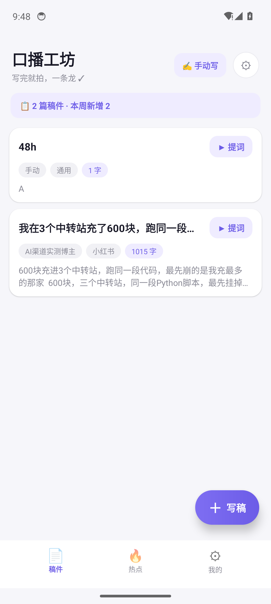
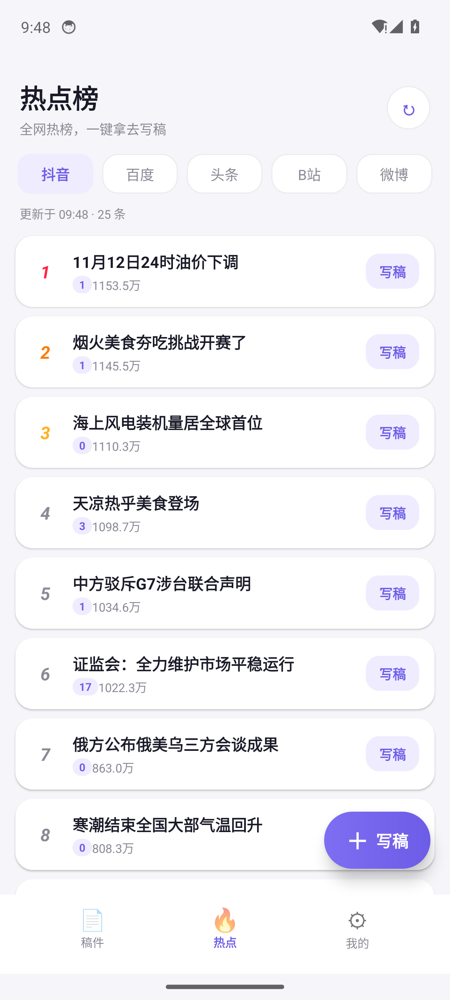
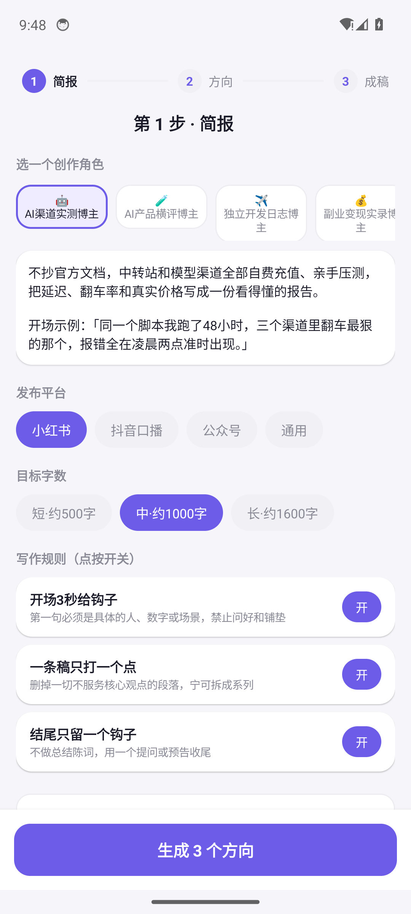
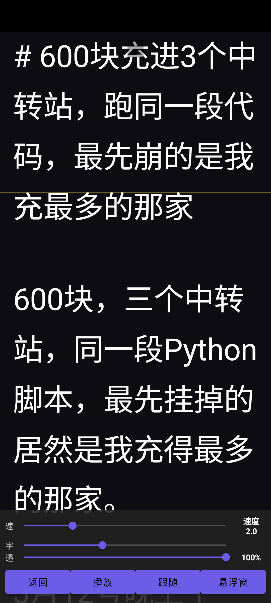
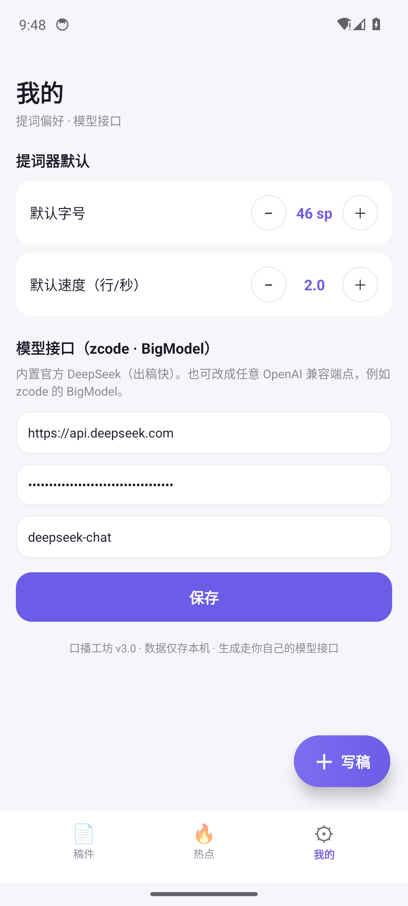

<div align="center">

# 口播工坊 Koubo Teleprompter

**开源的 AI 口播工作台：AI 写稿 → 全网热点 → 全屏/悬浮提词 → 语音跟随**

**An open-source AI-powered teleprompter & script studio for short-video creators (Android / Kotlin)**

[](LICENSE)


[](https://gitee.com/maxiaodiHome/voice-over-machine)

</div>

> **这是什么？** 口播工坊是一款面向短视频口播创作者的**免费开源** Android 应用：用 AI（DeepSeek 或任意 OpenAI 兼容接口）三步生成口播稿，聚合抖音/百度/头条/B站/微博五大平台热搜找选题，写完直接全屏提词拍摄，或把提词窗**悬浮**在相机 App 上边拍边念，并支持**语音跟随**（念到哪、稿子滚到哪）。所有数据只存本机，API Key 由使用者自备，不经过任何中间服务器。
>
> **What is it?** A free & open-source Android teleprompter app for spoken-video (口播/ talking-head) creators: 3-step AI script writing via DeepSeek or any OpenAI-compatible API, a 5-platform hot-search aggregator (Douyin/Baidu/Toutiao/Bilibili/Weibo), full-screen and camera-overlay floating teleprompter, and offline voice-follow auto-scrolling powered by sherpa-onnx streaming speech recognition. 100% local storage, bring-your-own API key.

| 稿件库 | 热点榜 | AI 写稿 | 全屏提词 | 我的 |
|:---:|:---:|:---:|:---:|:---:|
|  |  |  |  |  |

## 📲 下载安装 / Download

**免编译直装**：到 [Releases](https://github.com/MMMxd/koubo-teleprompter/releases/latest) 下载 `koubo-teleprompter-v4.6.apk`（约 95MB，**内置离线语音模型**），Android 6.0+ 手机直接安装。

**Direct APK**: [koubo-teleprompter-v4.6.apk](https://github.com/MMMxd/koubo-teleprompter/releases/download/v4.6/koubo-teleprompter-v4.6.apk) · No build required, offline ASR model bundled.

想自己编译看下面的[构建](#️-构建与运行--build)章节。

## ✨ 功能特性 / Features

| 功能 | 说明 |
| --- | --- |
| 🤖 **AI 三步写稿** | 选角色 → 生成 3 个选题方向 → 一键成稿，流式输出约 1~3 分钟。内置「AI渠道实测博主」等多个创作人格，可自定义角色、平台（小红书/抖音口播/公众号/通用）与目标字数 |
| 🔥 **全网热点榜** | 聚合抖音、百度、头条、B站、微博五大热搜（各源独立抓取互不影响），20 分钟内存缓存；点「写稿」自动把热点标题填进创作简报 |
| 📺 **全屏提词器** | 大字滚动 + 金色定位线，速度 / 字号 / 透明度三个滑杆实时可调，播放暂停随时控 |
| 🎥 **悬浮提词** | 独立进程悬浮窗挂在相机 App 上层，边拍边念不切屏；面板可调滚动、速度、字号、透明度、高亮与跟随 |
| 🎙️ **语音跟随** | 离线流式语音识别（sherpa-onnx zipformer2 中文模型，约 26MB int8），念到哪句、稿子滚到哪句、当前句琥珀色高亮；识别引擎跑在独立 `:speech` 进程，崩溃不影响 UI |
| 📚 **稿件库** | 稿件本地统一管理：编辑、分享导出、一键提词；卡片直达「▶ 提词」 |
| 🌙 **细节** | 常驻「＋写稿」悬浮按钮一键开写、三 Tab 原位丝滑切换、全局页面转场动画、深色提词主题 |

## 🤖 AI 与隐私 / AI & Privacy

- **模型接口自带 Key**：默认接口地址 `https://api.deepseek.com`，可在「我的」页改成任意 OpenAI 兼容端点（如 zcode/BigModel、SiliconFlow 等）。API Key 通过 `local.properties`（构建期）或 App「我的」页（运行期）配置，**源码与仓库中不含任何密钥**。
- **数据全部本地**：稿件、偏好、热搜缓存只存设备本机；请求只发生在「AI 生成」与「抓热搜」时，且直连你填的接口/公开榜单，没有自建服务器。
- **语音识别离线**：ASR 模型打包在 APK 内，语音跟随不联网。

## 🏗️ 构建与运行 / Build

环境：JDK 17 + Android Studio（AGP 8.5 / compileSdk 34 / minSdk 26）

```powershell
# 1. 在 local.properties（不进仓库）里配置：
sdk.dir=D:\\path\\to\\android-sdk
llmKey=sk-你的DeepSeek密钥        # 也可启动后在 App「我的」页填写

# 2. 补两个本机大文件（见下表），然后：
.\gradlew assembleDebug
```

产物：`app/build/outputs/apk/debug/app-debug.apk`（arm64-v8a + x86_64 双架构）

### 本地大文件说明（不进 git）

新 clone 出来的仓库**不能直接编译**，需要手动补两个文件：

| 文件 | 作用 | 来源 |
| --- | --- | --- |
| `app/libs/sherpa-onnx-2.0.1.aar`（48MB） | 语音识别引擎 | [sherpa-onnx releases](https://github.com/k2-fsa/sherpa-onnx/releases) 下载同名版本 |
| `app/src/main/assets/model/`（约 26MB） | zipformer2 中文流式 CTC 模型三件套：`model.int8.onnx` + `tokens.txt` + `bbpe.model` | 推荐官方模型 `streaming-zipformer-small-ctc-zh-int8-2025-04-01`，从 [k2-fsa/icefall 模型发布](https://github.com/k2-fsa/sherpa-onnx/releases/tag/asr-models) 获取 |

> 不补 AAR 编译不过；不补模型编译能过但语音跟随不可用（其余功能正常，引擎进程异常只影响跟随，UI 不闪退）。

## 🧱 技术架构 / Tech Stack

- **语言/UI**：Kotlin + 传统 View 体系（无 Compose），Material Components 主题
- **AI 请求**：OkHttp 直连 OpenAI 兼容接口，SSE 流式解析
- **热点聚合**：五源并行抓取（各源独立线程，单源失败不影响其它源），内存缓存 20 分钟
- **语音跟随**：sherpa-onnx 2.0.1（zipformer2 CTC 中文流式识别），识别引擎跑在 `:speech` 独立进程；主进程前台服务采集 PCM 经广播喂给识别进程——native 层 `exit(255)` 只死引擎进程，UI 永不闪退
- **悬浮提词**：SYSTEM_ALERT_WINDOW 悬浮窗 + 独立进程服务（specialUse|microphone 前台服务类型）
- **踩坑经验**：见 [docs/踩坑与经验](docs/踩坑与经验-20261112.md)——8 个真实事故的复现、根因与修复（AGP8 BuildConfig、SwitchCompat NPE、sherpa native 静默闪退、Kotlin R 常量内联闪退等）

## ❓ 常见问题 / FAQ

**Q：收费吗？需要注册吗？**
免费开源（MIT），无账号体系。你只需要一个自己的 DeepSeek/OpenAI 兼容 API Key 用于 AI 写稿；不写稿、只用提词器则完全离线可用。

**Q：我的稿件和 API Key 会上传吗？**
不会。数据只存本机；AI 请求直连你配置的接口，App 没有任何自建后端。仓库源码经 `sk-` 全量扫描，不含密钥。

**Q：语音跟随的实现原理？**
离线流式 ASR（sherpa-onnx zipformer2 中文 int8 模型）识别正在念的句子 → 与稿件全文做实时对齐 → 滚动定位到当前句并琥珀色高亮。模型打包在 APK 里，识别全程不联网。

**Q：和普通提词器 App 有什么区别？**
一体化：找选题（全网热搜）→ 写稿（AI 三步出稿）→ 拍摄（悬浮提词挂相机）→ 语音跟随，全链路在一个免费开源 App 里完成，且识别引擎进程隔离、原生层崩溃不影响提词。

**Q：支持哪些机型？**
Android 6.0（API 26）及以上，arm64-v8a 真机为主（模拟器可跑 x86_64）。

## 📄 许可证 / License

[MIT](LICENSE) © 2026 MMMxd —— 可自由使用、修改、二次开发，请保留版权声明。

> 觉得有用的话，点个 ⭐ Star 就是最大的支持！/ If this helps you, a ⭐ is the best support!
